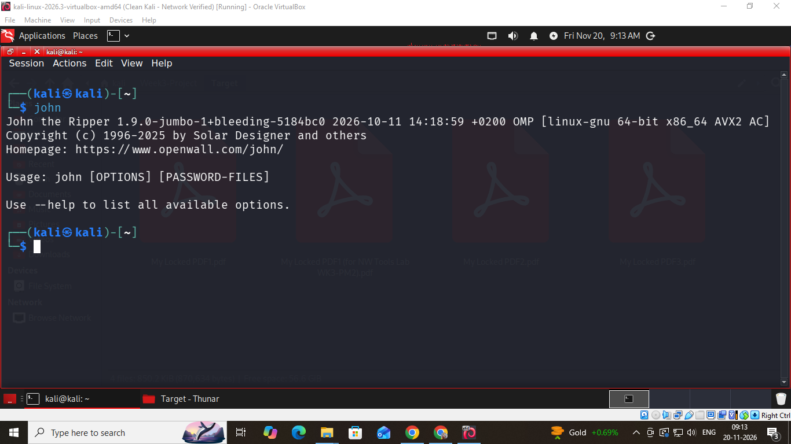
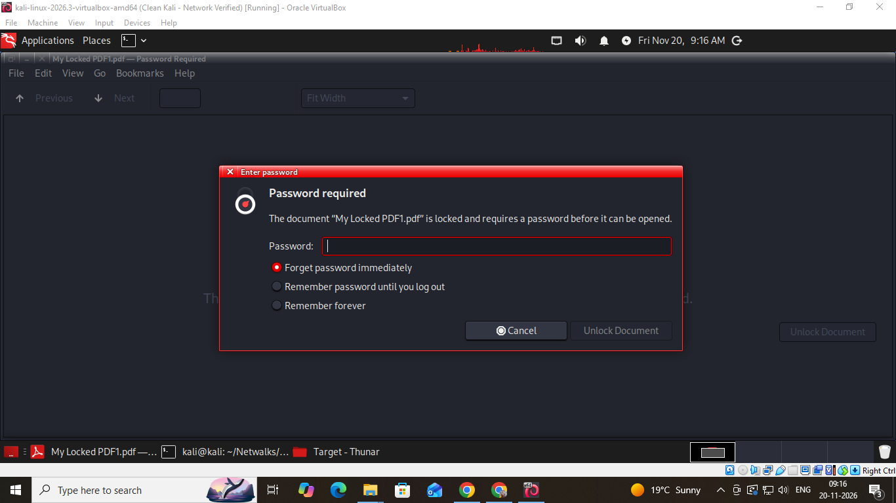
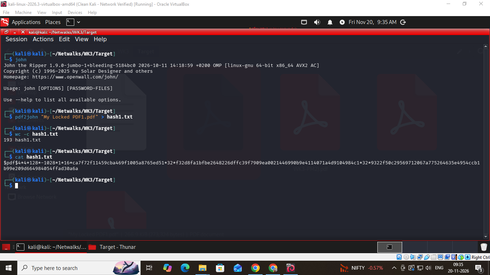
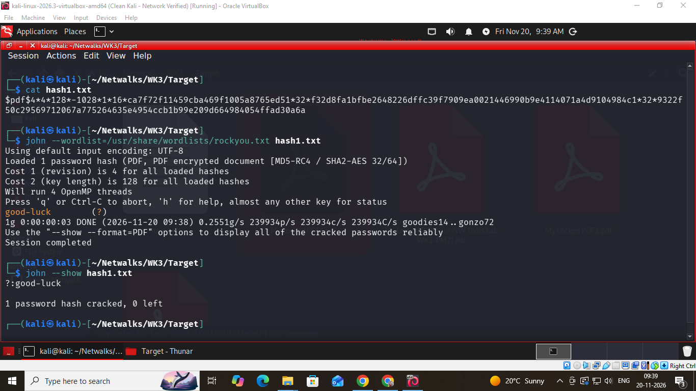
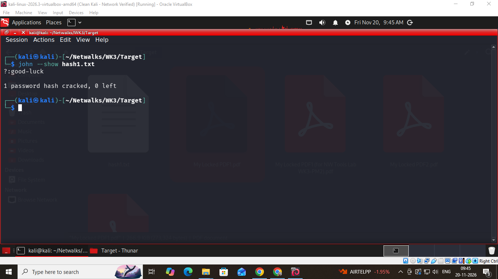
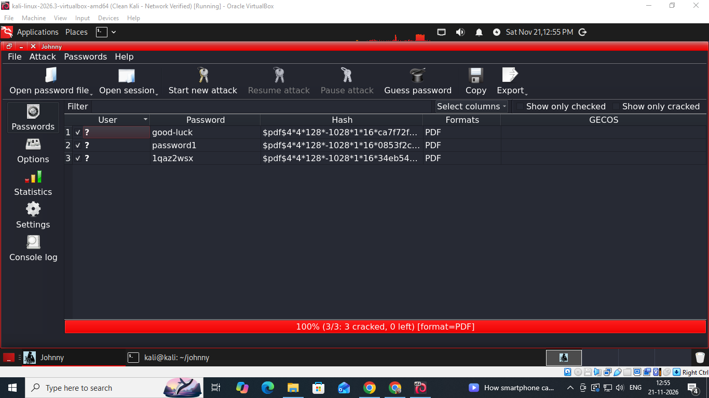
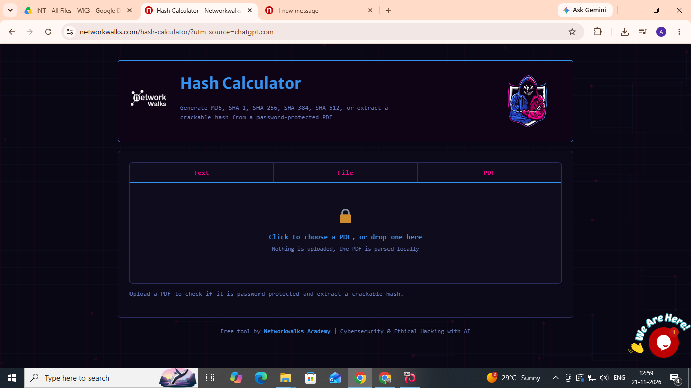
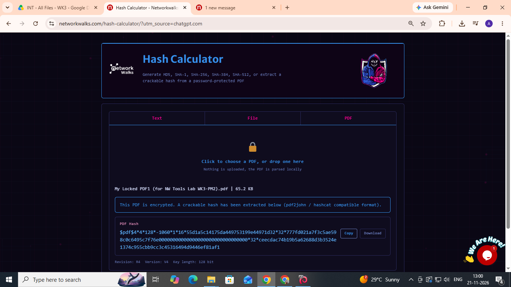
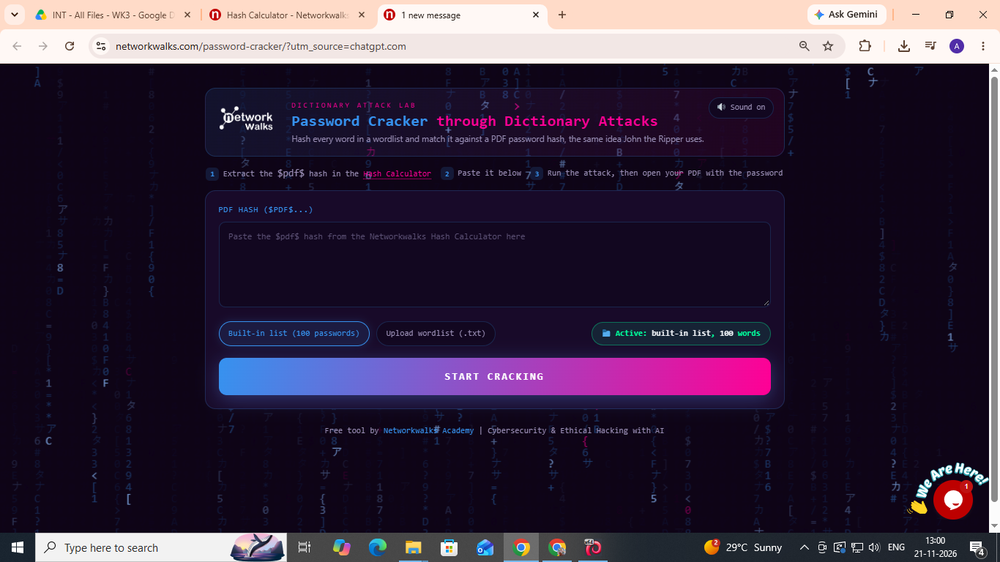
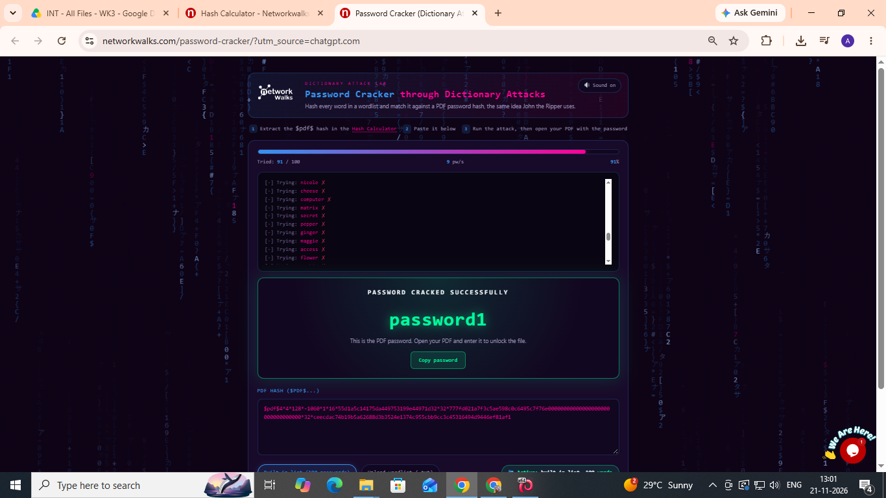

# Week 3 Project — Password Cracking with John the Ripper and Networkwalks Tools

## Project overview

This report combines the two compulsory Week 3 modules into one submission:

- **W3-PM1 — Password Cracking with John the Ripper (JTR):** recover the password of the supplied password-protected PDF using John the Ripper from the Kali Linux command line and demonstrate the Johnny graphical interface.
- **W3-PM2 — Password Cracking with Networkwalks Tools:** extract the PDF password hash with the Networkwalks Hash Calculator and submit that hash to the Networkwalks Password Cracker.

The exercises use training PDFs supplied for the Networkwalks lab. All testing described here is limited to those supplied files and the associated training tools.

## Lab environment

| Item | Environment / observed value |
|---|---|
| Operating system for local JTR work | Kali Linux 2026.3, running in Oracle VirtualBox |
| John the Ripper | `1.9.0-jumbo-1+bleeding-5184bc0` (Linux GNU, 64-bit x86_64; version output shown in Screenshot 01) |
| PDF hash extractor for PM1 | `pdf2john` |
| Dictionary for PM1 | Kali `rockyou.txt` wordlist |
| GUI | Johnny, built from source |
| PM2 tools | Networkwalks Hash Calculator and Networkwalks Password Cracker in a web browser |


## Project workflow

The two modules both involve recovering a password from a protected PDF, but they use separate hash extraction and cracking workflows. The hashes are specific to their respective input files and must not be mixed.

---

## W3-PM1 — Password Cracking with John the Ripper

### 1. Confirm the Kali / John environment

John was available in Kali. Its version output is shown in .

```bash
john
```

The supplied PDF was opened first to confirm that it prompted for a password. See .

### 2. Extract the PDF hash locally

From the directory containing the PM1 target PDF, the hash was extracted with `pdf2john` and saved to `hash1.txt`:

```bash
pdf2john "My Locked PDF1.pdf" > hash1.txt
wc -c hash1.txt
cat hash1.txt
```

The captured terminal shows a 193-byte `hash1.txt` file and a PDF hash beginning with `$pdf$`. See . The complete hash is retained in the working file; it is not reproduced in this README.

### 3. Prepare the RockYou wordlist

On Kali installations where the RockYou wordlist is present as a compressed archive, extract it while keeping the original `.gz` file:

```bash
sudo gzip -dk /usr/share/wordlists/rockyou.txt.gz
```

The `-k` option keeps the compressed source file. The resulting `/usr/share/wordlists/rockyou.txt` is the wordlist used by the command below. If the uncompressed file already exists, this extraction step is not needed.

### 4. Run the John the Ripper dictionary attack

The captured command was:

```bash
john --wordlist=/usr/share/wordlists/rockyou.txt hash1.txt
```

John loaded one PDF password hash and completed the dictionary run. The recovered password displayed in the terminal was **`good-luck`**. See .

To display the result from John’s pot file:

```bash
john --show hash1.txt
```

The captured output shows `?:good-luck` and confirms **1 password hash cracked, 0 left**. See .

### 5. Build and launch Johnny on Linux

The PM1 guide demonstrates Johnny as the graphical interface for John. For this Kali/Linux environment, Johnny was built from source. The commands used for the build are included below:

```bash
sudo apt install g++ git qtbase5-dev

git clone https://github.com/openwall/johnny.git
cd johnny
git checkout v2.2

export QT_SELECT=qt5
qmake
make -j2
./johnny
```

Johnny opened successfully. The supplied GUI evidence shows a session containing three PDF-format hash entries, with the status **100% (3/3: 3 cracked, 0 left)**. The three visible recovered values are `good-luck`, `password1`, and `1qaz2wsx`. See .

**Scope clarification:** The Johnny screenshot shows three hash rows but does not display the source filenames for those rows. It is therefore evidence of a Johnny GUI session with three cracked PDF-format entries; it is not used here to assign each visible password to a particular PDF filename.

### 6. Verify the PM1 result

The supplied `My Locked PDF1.pdf` was opened successfully. The unlocked page displays the Networkwalks training flag:

```text
nw{cybersecurity_flag_captured_2608}
```

See . The corresponding supplied unlocked PDF is included as `unlocked-pdfs/PM1-JTR-unlocked-PDF1.pdf`.

---

## W3-PM2 — Password Cracking with Networkwalks Tools

### 1. Open the Networkwalks Hash Calculator

The Networkwalks Hash Calculator was opened in the browser:

<https://networkwalks.com/hash-calculator/>

The initial interface is shown in .

### 2. Extract the PM2 PDF hash

The PM2-specific input file was selected:

`My Locked PDF1 (for NW Tools Lab WK3-PM2).pdf`

The calculator identified the PDF as encrypted and generated a crackable hash beginning with `$pdf$`. The output also displayed PDF revision R4, version V4, and a 128-bit key length. See .

The hash generated for this PM2 file is distinct from the PM1 hash extracted locally with `pdf2john`.

### 3. Submit the hash to the Networkwalks Password Cracker

The Networkwalks Password Cracker was opened:

<https://networkwalks.com/password-cracker/>

The extracted PM2 hash was pasted into the input area. The screenshot shows the built-in list containing 100 passwords selected before the attack. See .

### 4. Run the attack and record the result

The attack completed successfully and displayed **`password1`** as the recovered PDF password. The result screenshot shows the success message and the attempt counter at 91/100 when the match was found. See .

### 5. Verify the PM2 output

The supplied PM2 unlocked PDF contains the following Networkwalks flag:

```text
nw{networkwalks_flag1_jtr_270521_1}
```

The file is included as `unlocked-pdfs/PM2-Networkwalks-unlocked-PDF1.pdf`.

---

## Results summary

| Module / evidence | Hash recovery method | Cracking method | Recovered password | Verification result |
|---|---|---|---|---|
| W3-PM1 | Local `pdf2john` extraction | John the Ripper CLI with `rockyou.txt` | `good-luck` | PM1 PDF opened; flag shown in Screenshot 07 |
| W3-PM1 GUI demonstration | Hashes loaded into Johnny | Johnny graphical interface | GUI displays `good-luck`, `password1`, `1qaz2wsx` | Johnny reports 3/3 PDF-format entries cracked; source filenames are not shown in the GUI screenshot |
| W3-PM2 | Networkwalks Hash Calculator | Networkwalks Password Cracker, built-in 100-word list | `password1` | Supplied PM2 unlocked PDF contains the PM2 flag |

## Supplementary unlocked PDFs

Two additional one-page unlocked PDFs were supplied alongside the two primary module outputs. Their contents include these flags:

| File included in this bundle | Flag found in the supplied PDF |
|---|---|
| `unlocked-pdfs/Supplementary-unlocked-PDF2.pdf` | `nw{networkwalks_persistence_jtr_270521}` |
| `unlocked-pdfs/Supplementary-unlocked-PDF3.pdf` | `nw{networkwalks_flag_260821_1}` |

These are recorded as supplementary supplied artefacts. The screenshot set does not establish which cracking workflow or password corresponds to each supplementary filename, so no such mapping is claimed.

## Comparison and observations

The PM1 workflow used a local Linux utility to extract the PDF hash and John the Ripper to test candidates from the RockYou wordlist. John provided terminal output and a separate `--show` command to report the recovered value. Johnny provided a graphical view of loaded PDF hashes and cracking status.

The PM2 workflow used a browser-based PDF hash extractor and a browser-based dictionary cracker. Its built-in list contained 100 entries, and the displayed match was found at attempt 91. The PM2 hash was generated from the PM2-specific PDF and is not the same evidence file as the local PM1 `hash1.txt`.

Both exercises demonstrate why short or commonly used passwords are vulnerable to dictionary attacks. The recovered strings in this report are passwords for the supplied training documents only; they must not be reused as real credentials.

## Conclusion

Both compulsory Week 3 modules were completed using their respective workflows. The PM1 evidence documents local PDF hash extraction, a successful John the Ripper dictionary attack, the recovered password, a Johnny GUI session, and the opened PDF flag. The PM2 evidence documents Networkwalks hash extraction, a successful browser-based dictionary attack, the recovered password, and the supplied unlocked PDF flag.

## Evidence folder

All screenshots are stored in `screenshots/` and are embedded above in workflow order. The unlocked PDF artefacts are stored separately in `unlocked-pdfs/` so they are not confused with the screenshots.

## Lab references

- Networkwalks, **W3-PM1 — Password Cracking with JTR**, supplied Week 3 project instructions, especially the task and solution workflow.
- Networkwalks, **W3-PM2 — Password Cracking with Networkwalks Tools**, supplied Week 3 project instructions, especially the browser-based hash extraction and password cracking workflow.
- John the Ripper: <https://www.openwall.com/john/>
- Johnny GUI source repository: <https://github.com/openwall/johnny>
- Networkwalks Hash Calculator: <https://networkwalks.com/hash-calculator/>
- Networkwalks Password Cracker: <https://networkwalks.com/password-cracker/>
